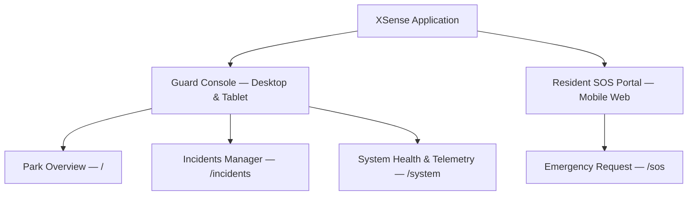
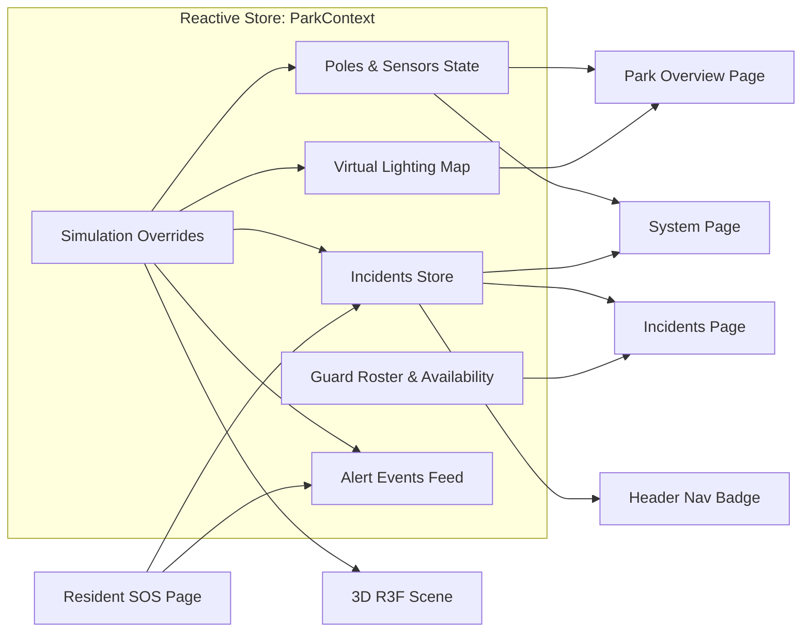
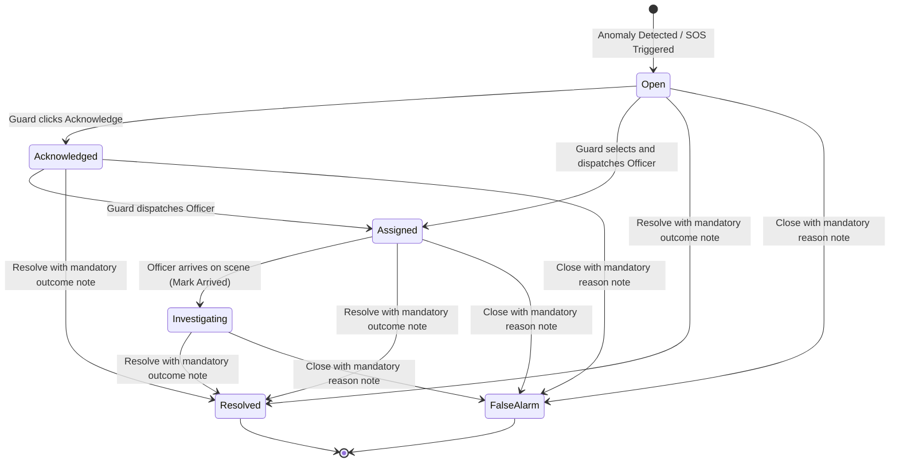
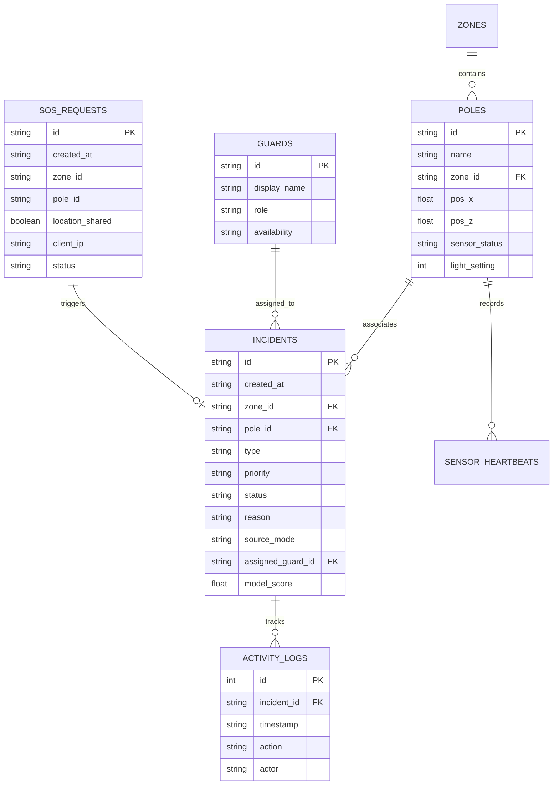

# XSense — System Design & Architecture Document

> **Privacy-Preserving Smart Park Safety System**  
> *Park safety without continuous optical surveillance.*

---

## 1. Executive Summary & Vision

**XSense** is a next-generation smart park safety system engineered to protect public recreation areas without relying on invasive, continuous video surveillance or facial recognition. By combining low-resolution spatial sensing (LiDAR / radar / depth), acoustic event classification, intelligent virtual lighting, and a frictionless resident SOS portal, XSense empowers park rangers and municipal guards to detect emergencies rapidly while safeguarding visitor civil liberties and personal privacy.

### Core Value Proposition
- **Privacy-by-Design:** No facial recognition, no biometric profiling, no permanent user tracking IDs, and no raw continuous video streams.
- **Explainable & Trustworthy:** Clear distinction between simulated signals, recorded benchmarks, and live inputs; confidence levels are explicitly presented as model scores rather than absolute proof.
- **Operator-Centric Experience:** A unified 3D digital twin console designed for low cognitive load during high-stress incidents, featuring large readable typography, high-contrast dark mode, and straightforward lifecycle state transitions.
- **Frictionless Resident Safety:** A mobile-first, zero-account emergency portal accessible via QR codes stationed throughout the park, offering opt-in location sharing and persistent direct emergency contact options.

---

## 2. Design System & User Experience Principles

### 2.1 Aesthetic & Visual Philosophy
1. **Calm, Clean & Trustworthy:** Built on a dark-mode-first aesthetic with deep slate backgrounds (`#0a101d`, `#111d2e`), subtle borders, and a calm teal brand accent (`#2db8b0`).
2. **Absence of Cyberpunk Clutter:** No gratuitous neon glows, vibrating badges, or overcomplicated telemetry readouts that increase guard fatigue.
3. **High Legibility:** Generous base font sizes (17–18px body text, 20–24px section headings) designed for rapid reading on wall-mounted consoles and tablets under varying lighting conditions.
4. **8px Modular Scale:** Strict spacing and layout cadence (`8px`, `16px`, `24px`, `32px`, `48px`).

### 2.2 Color Palette & Semantic Tokens

| Token | Hex Value | Semantic Purpose |
|---|---|---|
| `--bg-base` | `#0a101d` | Canvas backdrop |
| `--bg-surface` | `#111d2e` | Primary cards, panels, header |
| `--bg-elevated` | `#18283e` | Hover states, nested item cards |
| `--accent` | `#2db8b0` | Calm teal brand color, active navigation |
| `--urgent` | `#ef4444` | High-priority incidents, SOS alerts, active falls |
| `--needs-review` | `#f59e0b` | Acoustic distress, silent fall without sound |
| `--lighting` | `#facc15` | Low pathway lighting warnings |
| `--coverage` | `#a78bfa` | Sensor heartbeat failures, route obstructions |
| `--ok` | `#4ade80` | Normal operations, resolved cases, healthy telemetry |

### 2.3 Plain-English UI Translation Dictionary
To avoid ambiguous engineering jargon in frontline security consoles, all internal codes are mapped to clear human terms:

| Internal Code | UI Presentation Label | Contextual Meaning |
|---|---|---|
| `urgent` | **High Priority / Urgent** | Corroborated emergency or Resident SOS |
| `needs_review` | **Review Needed** | Single anomaly requiring human verification |
| `lighting_warning` | **Low Lighting** | Virtual illumination below safe threshold |
| `coverage_warning` | **Coverage Warning** | Offline sensor or blocked path |
| `simulated` | **SIMULATED** | Artificially injected demonstration event |
| `recorded` | **RECORDED SAMPLE** | Pre-recorded audio benchmark (e.g., YAMNet) |
| `live` | **LIVE INPUT** | Active connected physical input (never fabricated) |
| `open` | **Open** | Newly generated incident awaiting review |
| `investigating` | **In Progress** | Responding guard arrived on scene |

---

## 3. Information Architecture & Navigation

The application consists of two distinct user-facing environments served from a unified modular repository:



### 3.1 Guard Console Views
1. **Park Overview (`/`):**
   - **3D Digital Twin Viewer (~65% width):** Interactive real-time spatial map featuring orbit controls, day/night lighting modes, illustrative coverage zones, and dynamic visual indicators (acoustic ripples, blocked path barricades, fall highlights, rain particles).
   - **Summary Stats Bar:** Instant counts for items needing attention, dark pathways, and offline sensors.
   - **Inspection & Control Sidebar (~35% width):**
     - *Selected Area:* Pole telemetry details, sensor online/offline status, virtual lamp brightness slider (0–100%).
     - *Categorized Demo Scenarios:* Emergency Signals, Environment & Sensors, and Benign Telemetry.
     - *Recent Alerts Feed:* Chronological stream of incoming telemetry cards.

2. **Incidents Manager (`/incidents`):**
   - **Filter Tabs:** *All*, *Needs Review*, *Urgent*, *In Progress*, and *Closed*.
   - **Split Layout:**
     - *Left List:* Priority-coded incident cards displaying location, event type, timestamp, and provenance tags.
     - *Right Detail Panel:* Comprehensive incident dossier including exact zone/pole coordinates, detection rationale, model confidence score with safety disclaimers, assigned officer, lifecycle transition action buttons, and a chronological audit trail.

3. **System Health & Insights (`/system`):**
   - **Live Sensor Telemetry:** Real-time health status (`Online`, `Needs Attention`, `Offline`), last heartbeat timestamp, and active anomaly notes for every park pole.
   - **Lighting & Pathway Grid:** Current brightness percentages and pathway openness statuses (`Open` vs. `Route Closed`).
   - **Analytics & Incident History:** Summary metrics for active cases, resolved incidents, and false alarms, paired with a historical case archive.
   - **Privacy Policy & Boundaries:** Clear disclosure of data minimization policies.
   - **Simulation Management:** Master reset controls and quick scenario injections.

### 3.2 Resident SOS Portal (`/sos`)
- **Zero-Friction Access:** No account registration, password, or application download required; launched via QR code scan at any smart pole or park gate.
- **Location Context:** Automatic prefill of pole and zone coordinates from QR parameters (`?pole=AS-102&zone=lakeside_path`).
- **Opt-in Geolocation:** Browser GPS permission requested with transparent explanations; graceful fallback to manual zone selection if denied.
- **Real-Time Feedback:** Immediate transition through request lifecycle states (*Sending* $\rightarrow$ *Received* $\rightarrow$ *Guard Dispatched*).
- **Persistent Emergency Fallback:** Prominent, persistent "Call 999" action button that remains accessible regardless of network connectivity.

---

## 4. 3D Spatial Digital Twin Architecture

Built using **Three.js**, **React Three Fiber (R3F)**, and **Drei**, the 3D viewer provides an intuitive spatial representation of the park.

### 4.1 Spatial Coordinate Layout

```
                  [-15, -13]
               AS-101 (North Entrance)
                      │
                      │  [-4, -9]
                      │  AS-102 (Lakeside Path)  [10, -12]
                      │       \                   (Lake)
                      │        \
                  [1, 1] ───────
             AS-103 (Central Path)
                    /   \
                   /     \
       [-12, 10]  /       \  [14, 11]
 AS-104 (West Loop)       AS-105 (East Exit)
```

### 4.2 3D Scene Components
- **Terrain & Pathways (`ParkGeometry.tsx`):** Low-poly ground mesh, pedestrian asphalt paths, water body with subtle transparency, procedural trees, and park benches.
- **Dynamic Obstruction Barricade:** When an unsafe route scenario is triggered (e.g., Central Path), a physical 3D barrier mesh with hazard stripes and a `⛔ ROUTE CLOSED` warning tag dynamically appears on the affected pathway.
- **Atmospheric Effects:** Procedural precipitation particles render across the sky when benign rain acoustics are activated.
- **Smart Sensor Poles (`Pole.tsx`):**
  - Structural shaft, sensor enclosure, and directional lamp fixture.
  - Dynamic `pointLight` matching virtual brightness (0–100%).
  - Illustrative sensor coverage circles on the ground.
  - Interactive HTML nameplates with live status indicators.
  - **Acoustic Pulse Waves:** Concentric expanding ring geometry that pulses outward when acoustic distress is detected at that pole.
- **Anonymous Movement Dots (`AnonymousDot.tsx`):** Simulated pedestrian markers that traverse circular path trajectories. To preserve absolute privacy, markers display **zero facial geometry, names, or persistent identities**. During fall simulations, the marker stops motion and displays an amber alert halo.

---

## 5. State Management & Reactive Data Architecture

State is unified via a central React Context (`ParkContext.tsx`), ensuring seamless synchronization across tabs, routes, and simulation engines.



---

## 6. Incident Lifecycle & Workflow State Machine

The incident workflow enforces strict operational consistency, preventing invalid state transitions while recording a tamper-evident audit trail:



### Operational Rules Enforced:
1. **Mandatory Notes:** Closing an incident (either as `Resolved` or `False Alarm`) requires a non-empty human rationale note.
2. **Guard Availability Tracking:** When an officer is dispatched to an incident, their roster status transitions to `busy`. Upon case resolution or false alarm closure, the officer is automatically returned to `available`.
3. **Audit Trail Immutability:** Every status change, assignment, and note appends a timestamped log entry recording the action and the responsible actor.

---

## 7. Simulation Suite & Alert Rules Specification

| Scenario | Input Signature | Alert Level | UI Presentation & Provenance | Operational Action |
|---|---|---|---|---|
| **Silent Possible Fall** | Depth/position drop, dot stationary for >45s without sound | `needs_review` | **Review Needed** (`SIMULATED`) | Alert guard; verify visually. Does **not** require audio corroboration. |
| **Possible Distress Scream** | Acoustic classification score >0.80 | `needs_review` | **Review Needed** (`RECORDED SAMPLE`) | Highlight pole `AS-101` with acoustic pulse waves; prompt guard review. |
| **Combined Anomaly** | Simultaneous acoustic distress + fall at `AS-104` | `urgent` | **High Priority** (`SIMULATED`) | Corroborated multi-sensor emergency; immediate guard dispatch urged. |
| **Dark Pathway** | Virtual lamp reduced below 30% | `lighting_warning` | **Low Lighting** (`SIMULATED`) | Separate maintenance notice; path zone highlighted orange. |
| **Sensor Offline** | 3 consecutive missed telemetry heartbeats | `coverage_warning` | **Coverage Warning** (`SIMULATED`) | Warn monitoring is unavailable in area; never show "all clear". |
| **Unsafe Route** | Pathway obstruction on Central Path | `coverage_warning` | **Coverage Warning** (`SIMULATED`) | Deploy 3D barrier mesh; advise pedestrian diversion to West Loop. |
| **Benign Rain / Noise** | Ambient precipitation acoustics | `normal` | **Normal / Info** (`SIMULATED`) | Telemetry log only. **No emergency incident generated.** |
| **Resident SOS** | Web portal emergency trigger | `urgent` | **High Priority** (`SIMULATED`) | Immediate urgent alert; skips AI validation gate. |

---

## 8. Backend Architecture & API Specification

The backend service is designed in **Python** using **FastAPI**, **Pydantic**, **SQLAlchemy**, and native **WebSockets**.

### 8.1 Database Entity Schema



### 8.2 API Endpoints Matrix

| Method | Path | Purpose |
|---|---|---|
| `GET` | `/api/park` | Returns all static pole coordinates, zones, and current lighting |
| `GET` | `/api/incidents` | Query and filter active/past incidents |
| `GET` | `/api/incidents/{id}` | Retrieve incident details and full activity trail |
| `POST` | `/api/incidents/{id}/acknowledge` | Guard acknowledges receipt of alert |
| `POST` | `/api/incidents/{id}/assign` | Assign available officer to incident |
| `POST` | `/api/incidents/{id}/status` | Update incident status (`investigating`, `resolved`, `false_alarm`) |
| `POST` | `/api/sos` | Anonymous resident SOS submission (rate-limited per IP) |
| `POST` | `/api/demo/inject` | Inject simulated scenarios (strictly enforces simulated provenance tag) |
| `WS` | `/ws/updates` | Bi-directional WebSocket stream for real-time dashboard events |

---

## 9. Privacy, Ethics & Regulatory Safeguards

1. **No Continuous Optical Recording:** The system avoids continuous RGB optical recording. Telemetry relies on geometric depth/motion points and acoustic amplitude profiles.
2. **Absence of Biometrics:** No facial recognition models, gait identification databases, or visitor profiling mechanisms are implemented or supported.
3. **Strict Data Provenance:** Every signal presented to operators is cryptographically or programmatically labeled (`simulated`, `recorded`, `live`). The system strictly forbids labeling fabricated or mock data as "Live Input".
4. **Human-in-the-Loop Verification:** Detection confidence levels are explicitly presented as *statistical model scores*, never as proof of an emergency. The system never executes automated 999 calls without human confirmation.
5. **Resident SOS Consent:** Resident geolocation coordinates are collected exclusively with explicit, opt-in consent and discarded following incident resolution.

---

## 10. Technology Stack Summary

| Subsystem | Technology | Purpose |
|---|---|---|
| **Frontend Framework** | React 18, TypeScript, Vite | Fast, typed, reactive single-page architecture |
| **3D Rendering** | Three.js, React Three Fiber, Drei | Declarative spatial digital twin rendering |
| **Styling** | Vanilla CSS (Modular Tokens) | Lightweight, performant, themeable styling |
| **Routing** | React Router v6 | Independent guard and resident route management |
| **Backend Framework** | Python 3.11, FastAPI, Uvicorn | High-throughput asynchronous REST & WebSocket API |
| **Data Validation** | Pydantic v2 | Robust request/response schema validation |
| **Storage Engine** | SQLite + SQLAlchemy 2.0 | Zero-configuration relational database |
| **Audio Classification** | TensorFlow + YAMNet (Planned) | Acoustic distress inference on audio samples |
