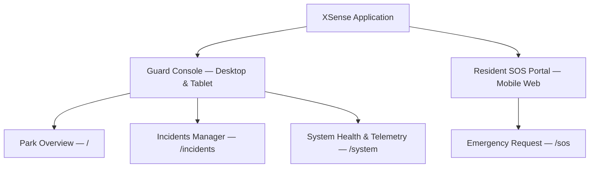
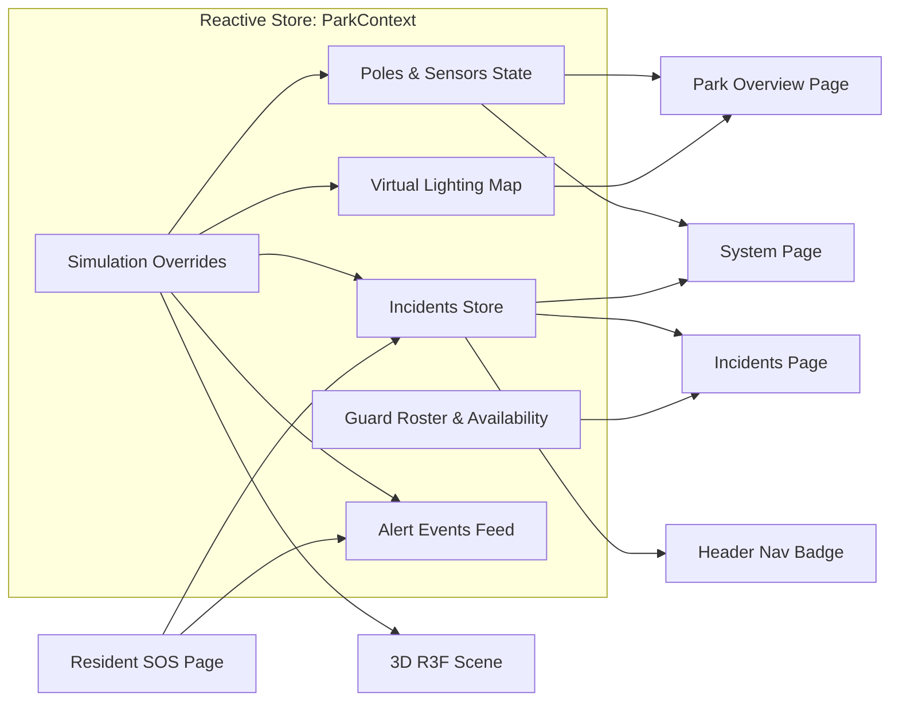
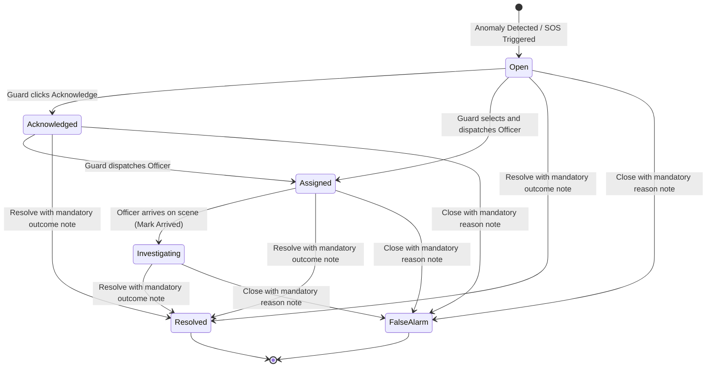
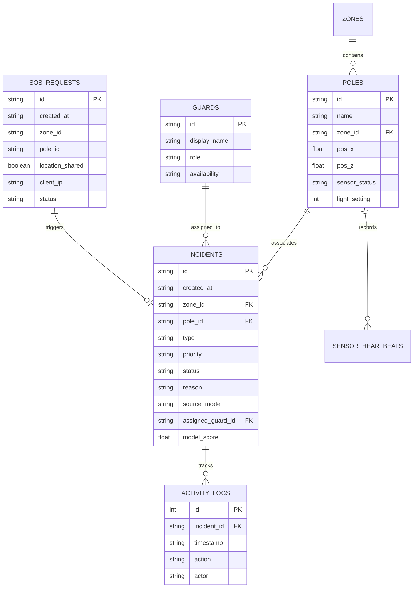

# XSense — System Design & Architecture Document

**Updated: 13 October 2026 · Target architecture, not a completed implementation**

> **Hybrid Park Safety System** — Understand coverage. Identify possible distress. Coordinate response.

## 1. Executive Summary & Vision

XSense brings existing CCTV context, targeted LiDAR and sound detection, resident SOS, and guard response into a shared 3D park interface. The primary value is monitoring awareness and coordinated assistance; privacy remains a supporting safeguard.

### Agreed direction

- Show CCTV locations, viewing directions, and estimated coverage.
- Locate LiDAR/audio in higher-risk areas with inadequate monitoring, established through site inspection, incident reports, and staff input. Streetlights are optional mounts, not placement rules.
- Compare lighting improvements, infrared CCTV, and LiDAR for each gap. Darkness alone does not justify LiDAR, sensing does not replace lighting, and LiDAR cannot see through opaque obstacles.
- Connect possible distress to location, available evidence, and actual guard actions. Silent unreported incidents with no distinctive signals may still be missed.
- Keep source observations separate from interpretations; no crime confirmation, automatic identity matching, or guaranteed protection.

### Implementation boundary

The current application contains browser-local simulations, guard markers, lighting, incidents, and SOS UI. FastAPI routes use in-memory stores. SQLite integration, server-enforced lifecycle consistency, cross-device updates, real YAMNet inference, CCTV inventory rendering, and independent sensor placement remain planned. The SOS acknowledgement timer must be removed; no status should claim a guard acted when they did not. The current simulated acoustic scenario's recorded-source label also needs correction.

Camera map inventory is the first stage. Authorized feeds, footage retrieval, PTZ control, and AI CCTV analytics are separate future integrations; markers do not imply any of them.

---

## 2. Design System & User Experience Principles

### 2.1 Aesthetic & Visual Philosophy
1. **Calm, Clean & Trustworthy:** Built on a dark-mode-first aesthetic with deep slate backgrounds (`#0a101d`, `#111d2e`), subtle borders, and a calm teal brand accent (`#2db8b0`).
2. **Absence of Cyberpunk Clutter:** No gratuitous neon glows, vibrating badges, or overcomplicated telemetry readouts that increase guard fatigue.
3. **High Legibility:** Generous base font sizes (17–18px body text, 20–24px section headings) designed for rapid reading on wall-mounted consoles and tablets under varying lighting conditions.
4. **8px Modular Scale:** Strict spacing and layout cadence (`8px`, `16px`, `24px`, `32px`, `48px`).

### 2.2 Color Palette & Semantic Tokens

| Token | Hex Value | Semantic Purpose |
|---|---|---|
| `--bg-base` | `#0a101d` | Canvas backdrop |
| `--bg-surface` | `#111d2e` | Primary cards, panels, header |
| `--bg-elevated` | `#18283e` | Hover states, nested item cards |
| `--accent` | `#2db8b0` | Calm teal brand color, active navigation |
| `--urgent` | `#ef4444` | High-priority incidents, SOS alerts, active falls |
| `--needs-review` | `#f59e0b` | Acoustic distress, silent fall without sound |
| `--lighting` | `#facc15` | Low pathway lighting warnings |
| `--coverage` | `#a78bfa` | Sensor heartbeat failures, route obstructions |
| `--ok` | `#4ade80` | Normal operations, resolved cases, healthy telemetry |

### 2.3 Plain-English UI Translation Dictionary
To avoid ambiguous engineering jargon in frontline security consoles, all internal codes are mapped to clear human terms:

| Internal Code | UI Presentation Label | Contextual Meaning |
|---|---|---|
| `urgent` | **High Priority / Urgent** | Related serious observations requiring review, or Resident SOS |
| `needs_review` | **Review Needed** | Single anomaly requiring human verification |
| `lighting_warning` | **Low Lighting** | Virtual illumination below demo threshold |
| `coverage_warning` | **Coverage Warning** | Offline sensor or blocked path |
| `simulated` | **SIMULATED** | Artificially injected demonstration event |
| `recorded` | **RECORDED SAMPLE** | Pre-recorded audio benchmark (e.g., YAMNet) |
| `live` | **LIVE INPUT** | Active connected physical input (never fabricated) |
| `open` | **Open** | Newly generated incident awaiting review |
| `investigating` | **In Progress** | Responding guard arrived on scene |

---

## 3. Information Architecture & Navigation

The application consists of two distinct user-facing environments served from a unified modular repository:



### 3.1 Guard Console Views
1. **Park Overview (`/`):**
   - **3D Digital Twin Viewer (~65% width):** Interactive real-time spatial map featuring orbit controls, day/night lighting modes, illustrative coverage zones, and dynamic visual indicators (acoustic ripples, blocked path barricades, fall highlights, rain particles).
   - **Summary Stats Bar:** Instant counts for items needing attention, dark pathways, and offline sensors.
   - **Inspection & Control Sidebar (~35% width):**
     - *Selected Area:* Device or lamp details, source/integration status, coverage basis and limitations; brightness controls apply to lamps only.
     - *Categorized Demo Scenarios:* Emergency Signals, Environment & Sensors, and Benign Telemetry.
     - *Recent Alerts Feed:* Chronological stream of incoming telemetry cards.

2. **Incidents Manager (`/incidents`):**
   - **Filter Tabs:** *All*, *Needs Review*, *Urgent*, *In Progress*, and *Closed*.
   - **Split Layout:**
     - *Left List:* Priority-coded incident cards displaying location, event type, timestamp, and provenance tags.
     - *Right Detail Panel:* Comprehensive incident dossier including zone/device location and optional mount reference, detection rationale, model confidence score with safety disclaimers, assigned officer, lifecycle transition action buttons, and a chronological audit trail.

3. **System Health & Insights (`/system`):**
   - **Live Sensor Telemetry:** Real-time health status (`Online`, `Needs Attention`, `Offline`), last heartbeat timestamp, and active anomaly notes for each device, independently of lighting mounts.
   - **Lighting & Pathway Grid:** Current brightness percentages and pathway openness statuses (`Open` vs. `Route Closed`).
   - **Analytics & Incident History:** Summary metrics for active cases, resolved incidents, and false alarms, paired with a historical case archive.
   - **Privacy Policy & Boundaries:** Clear disclosure of data minimization policies.
   - **Simulation Management:** Master reset controls and quick scenario injections.

### 3.2 Resident SOS Portal (`/sos`)
- **Zero-Friction Access:** No account registration, password, or application download required; launched via QR code scan at any smart pole or park gate.
- **Location Context:** Automatic prefill of pole and zone coordinates from QR parameters (`?pole=AS-102&zone=lakeside_path`).
- **Opt-in Geolocation:** Browser GPS permission requested with transparent explanations; graceful fallback to manual zone selection if denied.
- **Real-Time Feedback:** Server-confirmed transition through request lifecycle states (*Sending* $\rightarrow$ *Received* $\rightarrow$ *Guard Dispatched*).
- **Persistent Emergency Fallback:** Prominent, persistent "Call 999" action button that remains accessible regardless of network connectivity.

---

## 4. 3D Spatial Digital Twin Architecture

Built using **Three.js**, **React Three Fiber (R3F)**, and **Drei**, the 3D viewer provides an intuitive spatial representation of the park.

### 4.1 Existing Demo Pole Layout (not a deployment prescription)

```
                  [-15, -13]
               AS-101 (North Entrance)
                      │
                      │  [-4, -9]
                      │  AS-102 (Lakeside Path)  [10, -12]
                      │       \                   (Lake)
                      │        \
                  [1, 1] ───────
             AS-103 (Central Path)
                    /   \
                   /     \
       [-12, 10]  /       \  [14, 11]
 AS-104 (West Loop)       AS-105 (East Exit)
```

### 4.2 Existing Scene Components (hybrid additions in section 11)
- **Terrain & Pathways (`ParkGeometry.tsx`):** Low-poly ground mesh, pedestrian asphalt paths, water body with subtle transparency, procedural trees, and park benches.
- **Dynamic Obstruction Barricade:** When an unsafe route scenario is triggered (e.g., Central Path), a physical 3D barrier mesh with hazard stripes and a `⛔ ROUTE CLOSED` warning tag dynamically appears on the affected pathway.
- **Atmospheric Effects:** Procedural precipitation particles render across the sky when benign rain acoustics are activated.
- **Smart Sensor Poles (`Pole.tsx`):**
  - Structural shaft, sensor enclosure, and directional lamp fixture.
  - Dynamic `pointLight` matching virtual brightness (0–100%).
  - Illustrative sensor coverage circles on the ground.
  - Interactive HTML nameplates with live status indicators.
  - **Acoustic Pulse Waves:** Concentric expanding ring geometry that pulses outward when acoustic distress is detected at that pole.
- **Anonymous Movement Dots (`AnonymousDot.tsx`):** Simulated pedestrian markers that traverse circular path trajectories. Markers display **zero facial geometry, names, or persistent identities**. During fall simulations, the marker stops motion and displays an amber alert halo.
- **CCTV Inventory (`CameraAndGapOverlay.tsx`):** Camera mounts, aim direction and an **estimated** ground footprint derived from the documented mount/aim estimate (4.2m mount, 12m range, 60° horizontal field of view). The same estimate drives `utils/cameraCoverage.ts`, so the map and the incident camera line cannot disagree. A drawn footprint is not a live feed, does not prove identification or fall detection, and must not be described as verified coverage.

---

## 5. State Management & Reactive Data Architecture

Current browser state is unified via React Context (`ParkContext.tsx`) across views in one application instance; this does not synchronize separate browsers or devices. The target source of truth is SQLite through FastAPI, with WebSocket notifications and API/polling recovery. React holds the latest retrieved view, not authoritative guard assignments.



---

## 6. Incident Lifecycle & Workflow State Machine

Target workflow: enforce valid transitions and atomic assignments in the backend, with timestamped activity history. The current prototype does not provide tamper-evident storage or complete server enforcement:



### Operational Rules to Implement and Verify:
1. **Mandatory Notes:** Closing an incident (either as `Resolved` or `False Alarm`) requires a non-empty human rationale note.
2. **Guard Availability Tracking:** When an officer is dispatched to an incident, their roster status transitions to `busy`. Release the assignment on closure; represent return travel explicitly and make availability follow an agreed policy. Do not infer availability from animation completion alone.
3. **Activity History:** Every status change, assignment, and note appends a timestamped log entry recording the action and the responsible actor.

---

## 7. Simulation Suite & Alert Rules Specification

| Scenario | Input Signature | Alert Level | UI Presentation & Provenance | Operational Action |
|---|---|---|---|---|
| **Silent Possible Fall** | Simulated depth/position drop and prolonged low movement (45s is a demo parameter) | `needs_review` | **Review Needed** (`SIMULATED`) | Alert guard; use relevant video if available or an on-site check. Does **not** require audio corroboration. |
| **Possible Distress Scream** | Simulated acoustic score >0.80 (illustrative, not calibrated) | `needs_review` | **Review Needed** (`SIMULATED`; recorded only after processing a real clip) | Highlight pole `AS-101` with acoustic pulse waves; prompt guard review. |
| **Combined Anomaly** | Simultaneous acoustic distress + fall at `AS-104` | `urgent` | **High Priority** (`SIMULATED`) | Related observations support urgent human review; not confirmed danger. |
| **Dark Pathway** | Virtual lamp reduced below 30% | `lighting_warning` | **Low Lighting** (`SIMULATED`) | Separate maintenance notice; path zone highlighted orange. |
| **Sensor Offline** | 3 consecutive missed telemetry heartbeats | `coverage_warning` | **Coverage Warning** (`SIMULATED`) | Warn monitoring is unavailable in area; never show "all clear". |
| **Unsafe Route** | Pathway obstruction on Central Path | `coverage_warning` | **Coverage Warning** (`SIMULATED`) | Deploy 3D barrier mesh; offer an alternative only if explicitly verified; otherwise no route guidance. |
| **Benign Rain / Noise** | Ambient precipitation acoustics | `normal` | **Normal / Info** (`SIMULATED`) | Telemetry log only. **No emergency incident generated.** |
| **Resident SOS** | Web portal emergency trigger | `urgent` | **High Priority** (`SIMULATED`) | Immediate urgent alert; skips AI validation gate. |

### Persona sound cues (demonstration playback)

Operator-triggered persona actions (call for help, whistle, child crying, laughing, talking) play one audible cue at a time through a single frontend service (`personaAudioService`). Recorded cues use the ESC-50 samples served by `GET /api/audio/files/{id}`; the whistle is a clearly labelled synthesized tone because no recording exists. Playback is presentation only: it creates no incident, runs no YAMNet inference, and never marks an acoustic sensor as having heard anything. Mute and volume are local operator preferences, and a playback failure is reported in the HUD instead of failing silently.

---

## 8. Backend Architecture & API Specification

The backend service is designed in **Python** using **FastAPI**, **Pydantic**, **SQLAlchemy**, and native **WebSockets**.

### 8.1 Legacy Pole Model (migration reference)



### 8.2 Target Device and Coverage Model

Separate `devices` (camera, lidar, audio) from `poles` (lights/possible mounts). Device records carry stable ID, kind, zone, x/y/z, orientation, optional mount ID, source mode, heartbeat, and connection status. Detections reference device and zone IDs; pole IDs are optional legacy references. SOS may refer only to a zone and must not require a sensor.

`coverage_areas` reference devices and carry geometry, observation task, estimated/verified basis, healthy/degraded/unknown state, verification time, and limitations. A camera viewing volume is not proof of identification capability; a LiDAR envelope is not proof of person-down detection. Keep audio and lighting geometry separate.

`camera_integrations` later supply protected stream/evidence references and availability. Store credentials server-side, not in scene fixtures. Explicit event-to-camera associations must consider coverage and connection, not nearest distance alone. Initial manual zone mappings are acceptable.

### 8.3 API Endpoints Matrix (target contract)

| Method | Path | Purpose |
|---|---|---|
| `GET` | `/api/park` | Return zones, devices, coverage metadata, lamps, and integration availability (planned extension) |
| `GET` | `/api/incidents` | Query and filter active/past incidents |
| `GET` | `/api/incidents/{id}` | Retrieve incident details and full activity trail |
| `POST` | `/api/incidents/{id}/acknowledge` | Guard acknowledges receipt of alert |
| `POST` | `/api/incidents/{id}/assign` | Assign available officer to incident |
| `POST` | `/api/incidents/{id}/status` | Update incident status (`investigating`, `resolved`, `false_alarm`) |
| `POST` | `/api/sos` | Anonymous resident SOS submission (rate-limited per IP) |
| `POST` | `/api/demo/events` | Inject simulated scenarios (strictly enforces simulated provenance tag) |
| `WS` | `/ws/updates` | Planned change notifications; resync authoritative state through API after reconnect |

---

## 9. Data Safeguards and Operational Boundaries

- No facial recognition, biometric profiling, automatic guard identification through LiDAR, or continuous resident movement histories.
- CCTV views may be linked only through authorized integrations. Existing CCTV retention remains with its operator unless a separate evidence policy is agreed; no new continuous recording or rolling buffer is part of this plan.
- Label every input simulated, recorded, or live based on its actual origin. Programmatic labels are not cryptographic proof.
- Do not retain raw audio or point clouds by default. Limit incident access and define retention before deployment; do not claim automatic deletion already exists.
- SOS coordinates require informed opt-in. Show received only after persistence, acknowledged only after a guard action, and assigned only after a saved assignment.
- No autonomous emergency-service calls. Unknown coverage is not “all clear”; missing video requires an on-site check when appropriate.

---

## 10. Technology Stack Summary

| Subsystem | Technology | Purpose |
|---|---|---|
| **Frontend Framework** | React 18, TypeScript, Vite | Fast, typed, reactive single-page architecture |
| **3D Rendering** | Three.js, React Three Fiber, Drei | Declarative spatial digital twin rendering |
| **Styling** | Vanilla CSS (Modular Tokens) | Lightweight, performant, themeable styling |
| **Routing** | React Router v6 | Independent guard and resident route management |
| **Backend Framework** | Python 3.11, FastAPI, Uvicorn | High-throughput asynchronous REST & WebSocket API |
| **Data Validation** | Pydantic v2 | Robust request/response schema validation |
| **Storage Engine** | SQLite + SQLAlchemy 2.0 | Planned persistent relational storage |
| **Audio Classification** | TensorFlow + YAMNet (Planned) | Acoustic distress inference on audio samples |

## 11. Hybrid Map and Evidence Workflow

1. Operator selects camera, LiDAR/audio device, lamp, or incident; each has a distinct legend entry. Preserve cyan anonymous detections and separate blue simulated guard shields.
2. Independently toggle CCTV viewing coverage, LiDAR detection areas, audio zones, lighting, and gaps. Demo overlays are estimates; display provenance, freshness, and known obstructions.
3. Relate movement and sound only within a justified spatial/time window. Keep unrelated observations separate; audio never gates a silent possible fall or SOS.
4. Incident details explain observations, uncertainty, and camera availability. A compatible authorized feed can later be opened; inventory-only cameras show no invented image.
5. If no relevant view exists, show **“No camera view available. On-site check required.”** Nearby cameras may face away or be blocked.
6. Record real acknowledgement, assignment, arrival, outcome, and optional supervisor escalation. Staff availability remains an operational prerequisite.

## 12. Delivery and Validation Plan

The [implementation roadmap](docs/IMPLEMENTATION_ROADMAP.md) defines the seven delivery phases and their completion gates. The items below summarize architectural priorities, not separate phase numbering.

1. Persist incident/SOS/guard actions, validate transitions and availability, remove simulated acknowledgement, and implement retries/reconnection with polling fallback.
2. Decouple devices from lamp mounts; add camera inventory, estimated coverage, and explicit coverage gaps while preserving existing simulation features.
3. Demonstrate a small CCTV-covered entrance, LiDAR/audio path, overlap zone, and unknown area; test unavailable video and offline sensors.
4. Evaluate actual recorded audio and suitable LiDAR data when accessible. Compare each modality and their combination on silent events, harmless lookalikes, unrelated signals, occlusion, and noisy conditions.
5. Before a physical pilot, verify hardware, mounting, power, connectivity, weather performance, maintenance/tampering provisions, staffing, and total installed cost. Compare with adding infrared CCTV or fixing lighting; do not assert LiDAR superiority without evidence.

Measure false alerts per monitored hour, missed events, location error, delivery delay, response times, and recovery from outages. Use safe staged activities and evaluation sessions separate from tuning. Simulation proves workflow only. No universal safe radius, calibrated emergency probability, or field accuracy is claimed.

Open decisions: exact pilot site, hardware/budget, validated thresholds, camera integration permissions/protocols, retention, supervisor escalation policy, and optional physical help buttons. No hardware purchases, PTZ control, automatic emergency dispatch, or new video recording are authorized by this design.

References: [IR camera capabilities](https://whitepapers.axis.com/en-us/ir-in-surveillance), [LiDAR occlusion](https://docs.ouster.com/sdk-docs/features/zone_monitor/using-the-api.html), [audio limitations](https://whitepapers.axis.com/en-us/audio-analytics-for-security-and-safety).
